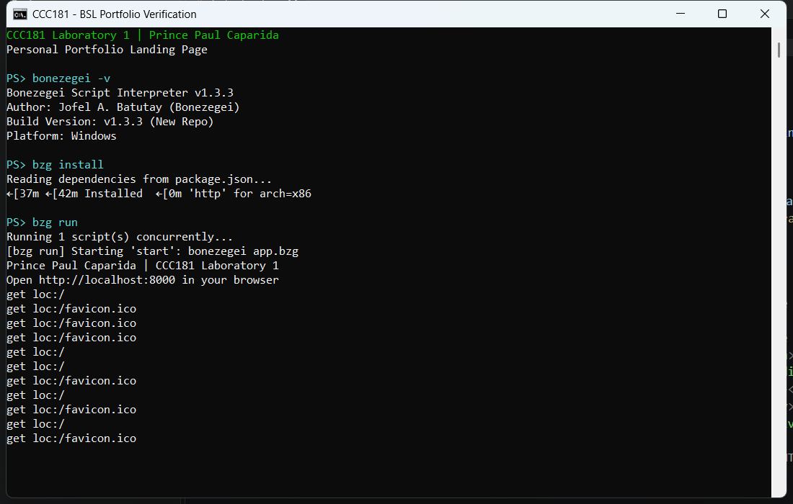
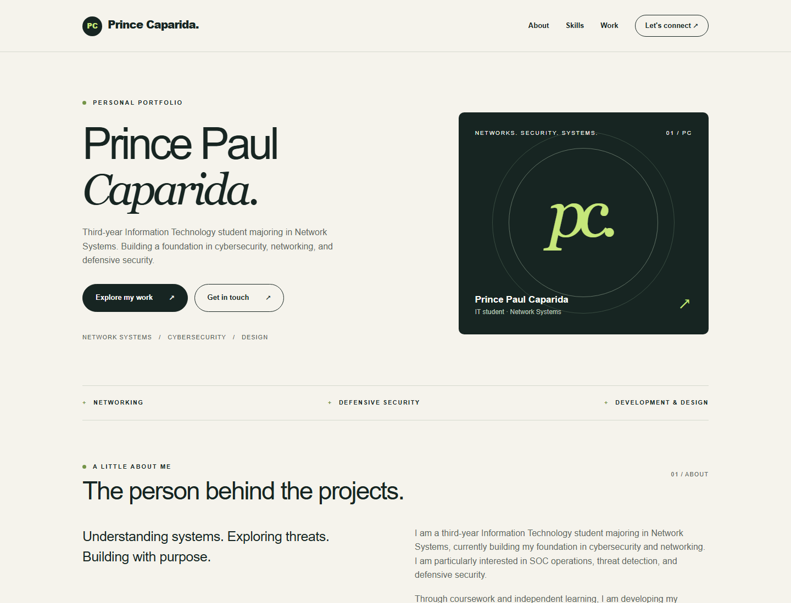
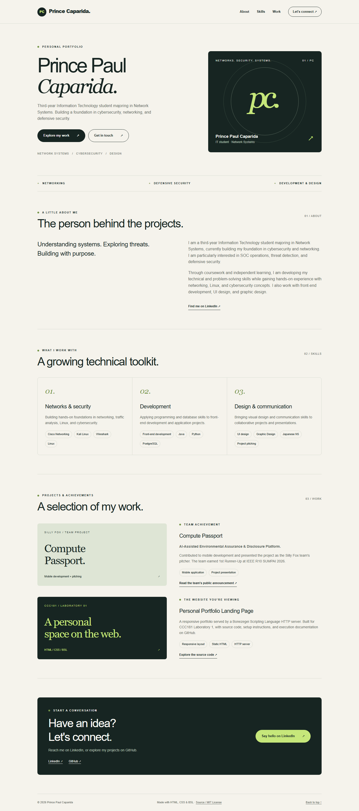
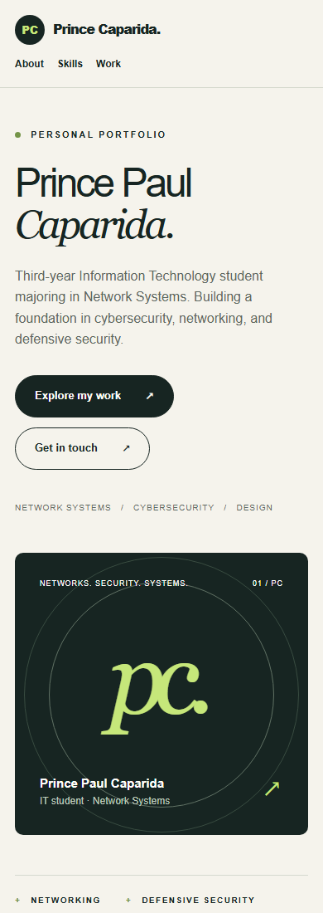

# Prince Paul Caparida — Personal Portfolio

CCC181: Application Development and Emerging Technologies · Laboratory 1.

## Project description

A personal portfolio for **Prince Paul Caparida**, a third-year Information Technology student majoring in Network Systems. It introduces his interests in SOC operations, threat detection, defensive security, and networking, alongside development and design skills.

The page includes a profile summary, skills and technologies, projects and achievements, and contact links to LinkedIn and GitHub. Compute Passport is presented as an **AI-Assisted Environmental Assurance & Disclosure Platform**. The second project documents this portfolio itself.

**Stack:** HTML5, responsive CSS, Bonezegei Scripting Language (BSL) **v1.3.3**, the BSL `http` library, Git, and GitHub. CSS is embedded in the HTML so the starter server can serve the entire page without additional asset routes. System fonts and CSS artwork keep rendering independent of external asset services.

## Repository setup

The project began by cloning the course reference:

```powershell
git clone https://github.com/msuiit-ph/BSL_HTTP_and_WebSocket.git
cd BSL_HTTP_and_WebSocket
```

An empty public repository was created at [RaiYuu08/Personal-Portfolio](https://github.com/RaiYuu08/Personal-Portfolio). The reference remote was preserved as `upstream`:

```powershell
git remote rename origin upstream
git remote add origin https://github.com/RaiYuu08/Personal-Portfolio.git
git push -u origin main
```

These commands have already been completed in this checkout; do not repeat them. Confirm with `git remote -v`. The original MIT license and copyright notice remain in [LICENSE](LICENSE).

## Setup & execution steps

### 1. Install BSL v1.3.3

On Windows, install **Bonezegei Scripting Language** from the Microsoft Store as instructed in the lab. The official Windows MSI is an alternative; see the [installation guide](https://bonezegei.com/tutorials/bsl/install). Verify the required version rather than assuming the latest release is v1.3.3.

Reopen PowerShell after installation:

```powershell
bonezegei -v
```

Expected version: `Bonezegei Script Interpreter v1.3.3`.

**Local setup used here:** the official [v1.3.3 Windows MSI](https://raw.githubusercontent.com/bonezegei/Bonezegei_Scripting_Language/v1.3.3/Release/Latest/Bonezegei-x86.msi) was downloaded and administratively extracted into `.tools/bsl`, without changing the system installation. This ignored directory is not included in a fresh clone. To reproduce that optional setup, run from the repository root:

```powershell
New-Item -ItemType Directory -Force .tools | Out-Null
Invoke-WebRequest 'https://raw.githubusercontent.com/bonezegei/Bonezegei_Scripting_Language/v1.3.3/Release/Latest/Bonezegei-x86.msi' -OutFile '.tools/BSL-1.3.3.msi'
$installerPath = Join-Path $PWD '.tools/BSL-1.3.3.msi'
$runtimeTarget = Join-Path $PWD '.tools/bsl'
Start-Process msiexec.exe -ArgumentList @('/a', ('"' + $installerPath + '"'), '/qn', ('TARGETDIR="' + $runtimeTarget + '"')) -WindowStyle Hidden -Wait
$env:PATH = "$PWD\.tools\bsl\Bonezegei;" + $env:PATH
bonezegei -v
```

The PATH change applies only to the current terminal session.

### 2. Configure VS Code

Open this repository in VS Code. In Extensions (`Ctrl+Shift+X`), install **Bonezegei Scripting Language Formatter**, ID `bonezegei-dev.vscode-bonezegei-formatter`. It is already installed on the development machine. `.vscode/extensions.json` recommends it for other users.

### 3. Install dependencies

Open the integrated terminal in the directory containing `package.json`:

```powershell
bzg install
```

This installs the HTTP library into `lib/`. The generated dependency directory is ignored by Git and can be recreated. This project uses the BSL package manager, not npm.

### 4. Start the server

```powershell
bzg run
```

This executes [app.bzg](app.bzg), loads `lib/http.bzg`, and starts the HTTP server on **port 8000**. The BSL VS Code extension's Run button is another option once the interpreter is available to VS Code.

For the local runtime in this checkout, use the helper. It sets PATH, prints the version, installs dependencies if missing, and runs `bzg run`:

```powershell
.\scripts\start-lab.ps1
```

Keep the terminal open and visit **[http://localhost:8000](http://localhost:8000)**. Stop the server with `Ctrl+C`.

### 5. Customize the page

Edit [public/index.html](public/index.html), save, and refresh the browser. It contains both content and responsive styles. `/` serves the portfolio; other paths serve `public/404.html`. The inherited WebSocket handlers remain in the server, although this static page does not use them.

### 6. Commit and push

```powershell
git add public/index.html app.bzg package.json README.md .gitignore .vscode scripts docs
git commit -m "Build personal portfolio and document BSL lab setup"
git push
```

## Execution verification

Verification uses the actual BSL v1.3.3 interpreter and HTTP dependency.

| Check | Result |
| --- | --- |
| Interpreter | BSL v1.3.3, Windows |
| VS Code formatter | Installed |
| `bzg install` | HTTP dependency installed for x86 |
| `bzg run` | Portfolio served on port 8000 |
| GET `/` | HTTP 200 and correct portfolio content |
| Missing URL | Reference fallback content returned |
| Internal links | All anchors resolve to section IDs |
| Package manifest | Valid JSON and MIT license declared |
| Desktop rendering | Actual Chrome capture |
| Mobile rendering | Actual Chrome capture |
| Repository visibility | Public, verified through GitHub API |

The fallback displays a 404 page; its HTTP status is inherited from the library and is not asserted to be HTTP 404.

### Terminal screenshot

Actual terminal execution with the BSL v1.3.3 runtime:



### Browser screenshot

Actual Chrome rendering fetched from `http://localhost:8000` while the BSL server was running:



### Full page and mobile captures





## Project structure

```text
Personal-Portfolio/
├── app.bzg                 # HTTP server and inherited WebSocket handlers
├── package.json            # BSL dependency manifest
├── public/
│   ├── index.html          # Portfolio and embedded CSS
│   └── 404.html            # Reference fallback page
├── scripts/start-lab.ps1   # Windows launch helper
├── .vscode/extensions.json # Recommended BSL extension
├── docs/screenshots/       # Execution evidence
├── .gitignore              # Runtime, generated dependencies, logs
├── LICENSE                 # Original MIT license and attribution
└── README.md
```

## Troubleshooting

- **Commands not recognized:** reopen your terminal after BSL installation, or use the local-runtime helper. A fresh clone does not include `.tools/`.
- **Missing `lib/http.bzg`:** run `bzg install` in the repository root.
- **Port 8000 occupied:** stop the previous server with `Ctrl+C` before starting another.
- **Browser cannot connect:** keep `bzg run` active and use HTTP, not HTTPS or a file URL.
- **Old content displayed:** save the HTML and refresh; use `Ctrl+F5` to bypass the browser cache.

## Content sources & attribution

The profile summary, year level, major, skills, and Compute Passport description were supplied by Prince Paul Caparida. His [LinkedIn profile](https://www.linkedin.com/in/prince-paul-caparida-85871431b/) is linked as the primary contact channel. No email address, education institution, or mobile framework was guessed.

A [public LinkedIn team announcement](https://ph.linkedin.com/in/gayneth-acol-976a8143a) credits Prince Paul with pitching and mobile development for Compute Passport and reports the team's 1st Runner-Up finish at IEEE R10 SUMPAI 2026. These details are attributed to that announcement.

Framework: [MSU-IIT reference repository](https://github.com/msuiit-ph/BSL_HTTP_and_WebSocket). Runtime: [Bonezegei Scripting Language](https://github.com/bonezegei/Bonezegei_Scripting_Language).

## Submission

Submit **https://github.com/RaiYuu08/Personal-Portfolio** to the official CCC181 Section 3 Laboratory 1 activity on MOLE. Submit the public repository link, rather than localhost. Confirm both required screenshots render on GitHub before submitting.

## License

MIT. See [LICENSE](LICENSE). The original copyright notice is preserved.
